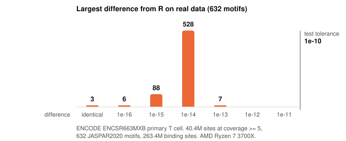
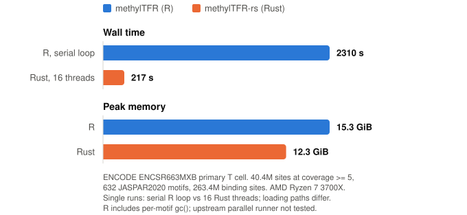
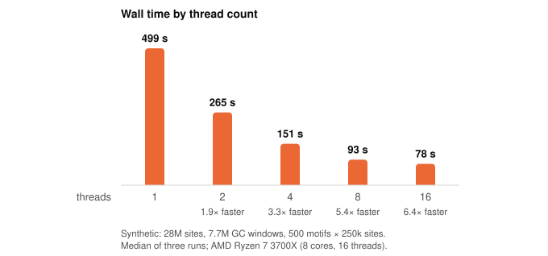

# methylTFR-rs

An independent, AI-assisted learning project porting the computational core of
[methylTFR](https://github.com/EpigenomeInformatics/methylTFR) to Rust.
The original method and R package are by Irem B. Gündüz, Sarath Kumar Murugan
and Fabian Müller. My contribution is the port and comparison scripts.

**Experimental and incomplete.** Numerical checks do not establish biological
validity or suitability for research use. This is not an official port;
corrections and feedback are welcome.

## Numerical agreement

Compared with methylTFR 0.99.9 on bundled examples, synthetic fixtures and
one whole-genome T-cell methylome. The plot shows absolute differences across
632 motifs in that sample, not an evaluation of biological accuracy.

<picture>
  <source media="(prefers-color-scheme: dark)" srcset="docs/img/realparity-dark.svg">
  
</picture>

## Runtime and memory

One run per implementation, with a sequential R motif loop and 16 Rust threads.
Loading paths differ, R includes per-motif garbage collection, and the upstream
parallel runner was not tested. These measurements describe this configuration.

<picture>
  <source media="(prefers-color-scheme: dark)" srcset="docs/img/realbench-dark.svg">
  
</picture>

## Thread scaling

Rust timings on a synthetic workload, using an AMD Ryzen 7 3700X
(8 cores, 16 threads). Median of three runs; results may differ on other inputs
and hardware.

<picture>
  <source media="(prefers-color-scheme: dark)" srcset="docs/img/scaling-dark.svg">
  
</picture>

## Usage and scope

```sh
cargo build --release
target/release/methyltfr run \
    --format bismarkcov --annotation tests/fixtures/batf sample.cov
```

Replace `sample.cov` with your input. Includes six input formats, GC-based
background correction, enhancer restriction and strand-aware mode. Plotting,
downstream statistics, Bioconductor objects and RnBeads input are not ported.
Broader testing and independent review remain needed.

[Evaluation details](docs/evaluation.md) ·
[Reference version](docs/reference-version.md) ·
[Known differences](docs/divergences.md) ·
[Annotation format](docs/AGENT_PLAN.md)

## Attribution

See the methylTFR [preprint](https://doi.org/10.64898/2026.09.29.755279)
(Gündüz, Nitsch, Murugan and Müller), [NOTICE](NOTICE) and [MIT licence](LICENSE).
