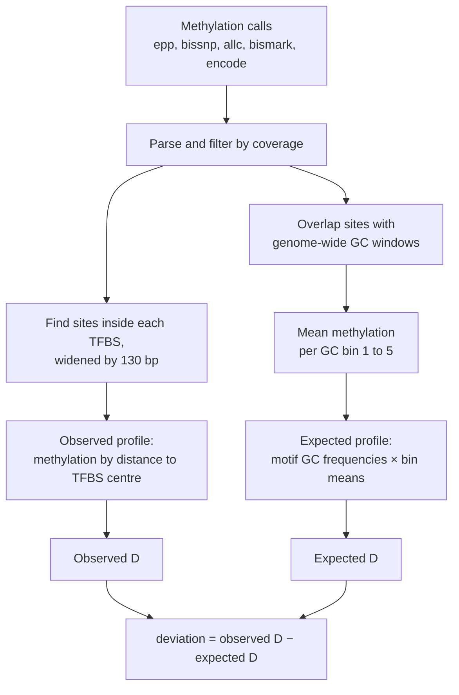
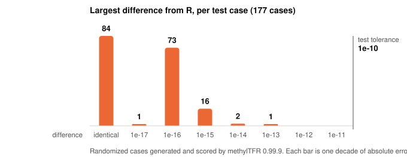
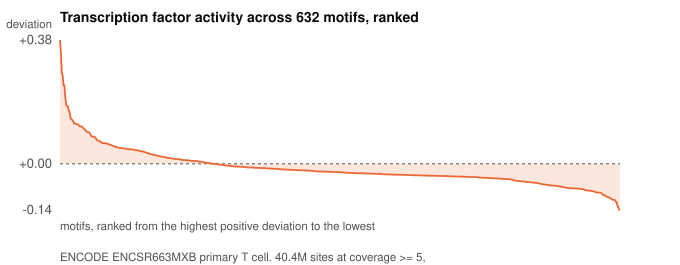
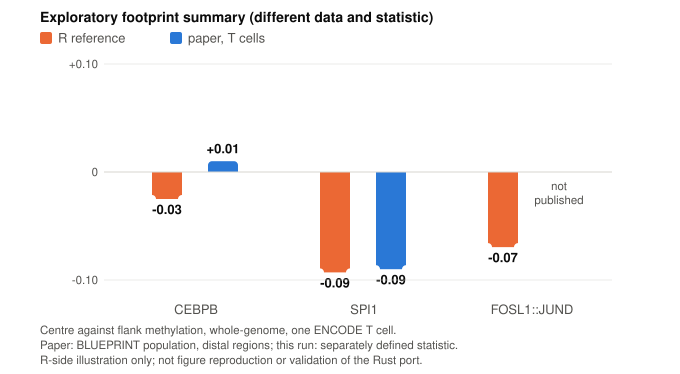
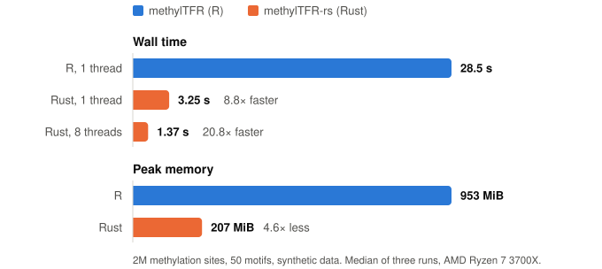

# Evaluation and implementation notes

An independent, AI-assisted learning project exploring a Rust implementation of
the computational core of [methylTFR](https://github.com/EpigenomeInformatics/methylTFR).
The original method and R package are the work of Irem B. Gündüz, Sarath Kumar
Murugan and Fabian Müller; the preprint also includes Regina Nitsch.

I started this project to learn about the method and explore AI-assisted
software development. My contribution is the port and its comparison scripts;
the biological method comes from the methylTFR authors.

> **Experimental, partial implementation.** Comparisons with a pinned R version
> show close numerical agreement on the included fixtures and one whole-genome
> T-cell methylome. These checks do not establish biological validity, complete
> compatibility, or suitability for research use. This is not an official port
> or a replacement for the upstream package. I would welcome corrections,
> particularly on the biological interpretation and evaluation design.

The implementation supports six methylation-call formats. The sections below
report numerical comparisons and exploratory benchmarks, with their scope and
limitations. Plotting, downstream statistics and the Bioconductor object layer
are outside the port's scope.

## What it computes

For each sample and motif, methylTFR asks: is methylation at the centre of this
factor's binding sites lower or higher than in the flanks, beyond what GC
content alone would predict?



`D` compares the middle of a profile with its edges. Positions are cut into five
intervals between −250 and +250 bp, each interval is averaged, and
`D = middle / mean(first, last)`. A value below 1 means the binding site is less
methylated than its surroundings. Subtracting the expected `D` applies the method's GC-based background correction;
this does not account for every possible source of bias.

## Usage

```sh
cargo build --release

target/release/methyltfr run \
    --format bismarkcov \
    --annotation tests/fixtures/batf \
    sample_1.cov
```

```
sample,motif,deviation,expected_deviation
sample_1.cov,BATF,1.7474268004931508,0.9798459267795762
```

The annotation directory holds `gc_windows.tsv` and a `motifs.tsv` manifest
pointing at one TFBS file and one GC-frequency matrix per motif.
`scripts/export_reference_data.R` converts methylTFR's `.rda` objects into these
plain TSV files. Other flags: `--motif`, `--enhancer`, `--strand-aware`,
`--cov-threshold`, `--keep-going`, `-o`.

## Parity with the R package

The comparison fixtures target selected core behaviour in methylTFR 0.99.9 at commit
[`8aeab03`](https://github.com/EpigenomeInformatics/methylTFR/commit/8aeab03cb469a9c213b7cd7fd2cbe6eeb8db5856).

<picture>
  <source media="(prefers-color-scheme: dark)" srcset="img/parity-dark.svg">
  
</picture>

Of 177 randomized cases scored by R, 84 match in every digit of every value and
the worst differs by 1.3e-13. The other checks:

- **Bundled BATF example:** differs from R by 2.2e-16, the last bit.
- **Error behaviour:** all 23 further cases where R raises an error also fail in Rust.
- **Parsers, six formats:** scores and coverage match `read_methylome()` bit-for-bit on the tested fixtures.
- **R numeric primitives** (`round`, `seq`, `cut`): bit-for-bit agreement on the R-generated test tables.
- **1 to 16 threads:** output files were byte-identical in the recorded thread-count checks.

The output is not byte-identical to R's, and is not meant to be: R sums in
extended precision and multiplies matrices through BLAS, so the last digit or
two can differ. Across thread counts the Rust output *is* byte-identical,
because parallelism is over motifs and never reorders a sum.

Implementation details covered by the comparisons include:

- `round(x, 6)` is not `(x * 1e6).round() / 1e6`. R gives `1/128 → 0.007812`;
  the naive version gives `0.007813`.
- `round()` goes half-to-even, which decides TFBS midpoints whenever the window
  width is even.
- The expected profile has no position 0 when its length is even.
- A methylation site spanning two GC windows is counted in both.

The three places where the port knowingly differs are listed in
[`docs/divergences.md`](divergences.md).

## Real data

Everything above is synthetic or bundled example data. This section is the same
comparison on a real published dataset, chosen because the methylTFR paper uses
it itself.

**The sample.** `ENCFF355UVU`, from ENCODE experiment `ENCSR663MXB`: a primary
human T cell, whole-genome bisulfite sequencing, GRCh38 bedMethyl, 58,607,924
CpG records. The paper's data availability section names four ENCODE methylomes
for its validation analysis — GM12878 (`ENCSR890UQO`), CD14+ monocytes
(`ENCSR017BUL`), B cells (`ENCSR284TCU`) and T cells (`ENCSR663MXB`) — and this
is the T-cell one, in the exact format and with the exact filter its methods
specify: *"ENCODE (GRCh38 bedMethyl, CpGs with coverage of at least 5)"*. That
filter leaves 40,410,035 sites.

**The annotation.** The published `methylTFRAnnotationHg38` objects (Zenodo record
22206980, CC-BY 4.0), the same ones the authors use: 632 JASPAR2020 motifs,
263,425,993 binding sites, 102,942,317 GC windows. `scripts/export_real_annotation.R`
converts them to the CLI's TSV directory, and
`scripts/verify_real_annotation.R` then checks the conversion back against the
originals — 1,904 checks, every GC-frequency value compared at 17 significant
digits, every GC-window column over all 102.9M rows. These conversion checks support comparison of the core calculation on matching
annotation inputs; they do not establish equivalence of the complete workflows.

**Agreement.** All 632 motifs, worst case 1.428e-13 against a tolerance of
1e-10. Only 3 motifs match R in every digit. Differences in floating-point reduction
and matrix multiplication are a plausible explanation for the small discrepancies;
the comparison does not isolate the cause of every difference.

<picture>
  <source media="(prefers-color-scheme: dark)" srcset="img/realparity-dark.svg">
  
</picture>

**Exploratory speed and memory comparison:** single run each, `/usr/bin/time`.
The R script loops over motifs sequentially; Rust uses 16 threads. This compares
these two configurations, not equal-resource performance or the upstream
parallel runner. The R script also calls `gc()` after each motif. Annotation
loading differs (RDS in R, exported TSV in Rust), and total process measurements
include loading and parsing. BLAS thread settings are not recorded in the summary.

Recorded wall times were 2,309.57 s for R and 216.84 s for Rust (a 10.65-fold
ratio). Peak RSS was about 15.3 GiB and 12.3 GiB respectively. Repeated runs and
matched thread settings are needed before drawing broader performance conclusions.

<picture>
  <source media="(prefers-color-scheme: dark)" srcset="img/realbench-dark.svg">
  
</picture>

The memory gap is much narrower here than on the 2M-site benchmark, and for a
good reason: both programs now hold the annotation. Rust keeps every motif's
binding sites resident, and at 32 bytes per interval those 263.4M sites are
8.4 GB of the 13.3 GB the run accounts for, alongside 3.3 GB of GC windows and
1.6 GB of methylation sites. The smaller synthetic workload also showed a larger memory ratio; these
measurements do not establish what to expect on other workloads.

**Core output:** deviation values for 632 motifs from this T-cell methylome.
These are computational outputs; their distribution alone does not validate
TF activity or binding.

<picture>
  <source media="(prefers-color-scheme: dark)" srcset="img/realresult-dark.svg">
  
</picture>

### Exploratory footprint comparison

`scripts/footprint_check.R` computes an uncorrected centre-to-flank methylation
summary using the R reference implementation. For context, the figure below
also shows two values transcribed from Figure 2E of the methylTFR preprint.

**This does not reproduce Figure 2E.** The script uses one ENCODE T-cell sample
rather than the paper's BLUEPRINT population, whole-genome rather than distal
regions, and a separately defined statistic rather than a verified implementation
of the authors' figure calculation. It is also an R-side analysis, not an
independent validation of the Rust implementation.

<picture>
  <source media="(prefers-color-scheme: dark)" srcset="img/footprint-dark.svg">
  
</picture>

The computed summaries are SPI1 -0.093, CEBPB -0.025 and FOSL1::JUND -0.070.
The cited paper values are -0.09 for SPI1 and +0.01 for CEBPB; the signs differ
for CEBPB. Similarity for selected motifs is descriptive and does not establish
statistical agreement, correct annotation or biological validity.

Reproducing the run needs no data in this repository. The sample and the
annotation are downloaded from ENCODE and Zenodo, and
[`docs/data/realdata_manifest.tsv`](data/realdata_manifest.tsv) records every
accession and SHA-256:

```sh
Rscript scripts/export_real_annotation.R <annotation_dir> <out_dir> all
Rscript scripts/verify_real_annotation.R <annotation_dir> <out_dir>
Rscript scripts/bench_real_r.R <annotation_dir> <sample.bed.gz> r.csv all
target/release/methyltfr run --format encode --annotation <out_dir> \
    --cov-threshold 5 -o rust.csv <sample.bed.gz>
python3 scripts/realdata_report.py <run_dir>
python3 scripts/plot_readme_figures.py
```

## Performance

Measured on an AMD Ryzen 7 3700X (8 cores, 16 threads); median of three runs,
wall time and peak RSS from `/usr/bin/time`. Inputs are synthetic.

**Against R** — 2M sites, 50 motifs. R is methylTFR 0.99.9 calling
`computeDeviation` once per motif on a single thread.

<picture>
  <source media="(prefers-color-scheme: dark)" srcset="img/benchmark-dark.svg">
  
</picture>

**Thread scaling** — 28M sites, 7.7M GC windows, 500 motifs × 250k binding sites.

<picture>
  <source media="(prefers-color-scheme: dark)" srcset="img/scaling-dark.svg">
  
</picture>

Peak memory is 5.4 GB at every thread count. Scaling flattens past 8 threads,
the machine's physical core count. Not yet measured: R on the 28M-site
dataset, and R with multiple workers.

[Real data](#real-data) reports a separate, single-run comparison on one
whole-genome methylome, with different thread counts and input-loading paths.

## How it was built

This port was written with AI models, with me directing and checking the work.
The development workflow was:

1. **Inspect the reference source and documentation.** A large model read the R implementation
   and re-ran the bundled example in plain R before any Rust existed. That
   surfaced the rounding rules above, and identified differences between the vignette values and the pinned
   example data. The fixture-version investigation is recorded in
   [`docs/reference-version.md`](reference-version.md).
2. **Write a spec a small model can follow.** The findings became
   [`docs/AGENT_PLAN.md`](AGENT_PLAN.md): every rule stated in Rust terms,
   split into small tasks, each with a command to check its output.
3. **Let R be the judge.** Test expectations are never typed by hand. R
   generates them, they are committed, and CI runs Rust alone against them.
4. **Hand implementation to a smaller model.** It worked through the tasks:
   numeric primitives first, then intervals, the core, parsers, CLI, and the
   200-case differential suite.
5. **Run a further AI-assisted review.** A larger model re-ran the test suite and
   re-did the benchmarks on a quiet machine, discarding an earlier set taken
   while another job was loading the CPU.

The development instructions prohibit changing tolerances, fixtures or expected
values to make a test pass. AI-assisted review is not independent expert review
and may share errors with the implementation process.

## Scope

Ported: methylome parsing, GC-bin means, expected profiles, TFBS matching,
deviation, enhancer restriction, strand-aware mode, CLI.

Not ported: plotting, the `methylTFRdeviations` object and its z-scores,
differential testing, variability ranking, RnBeads input, AnnotationHub. The
annotation packages are not redistributed here.

## Evaluation still needed

- Independent review of the implementation and biological interpretation.
- Additional real samples, cell types, sparse single-cell inputs and motif sets.
- Repeated timing and memory measurements with matched compute resources and
  comparison against the upstream parallel runner.
- Reproduction of a published analysis with matching data, regions and statistics.
- Downstream checks of whether numerical differences affect scientific conclusions.

## Development

```sh
cargo fmt --check
cargo clippy --all-targets -- -D warnings
cargo test --release        # 189 tests
```

## Credits and licence

methylTFR is by Irem B. Gündüz, Sarath Kumar Murugan and Fabian Mueller
(Epigenome Informatics), MIT licensed. This port contains none of its source
code; the test fixtures are derived from its example data. See [`NOTICE`](../NOTICE).

The [Real data](#real-data) section uses `ENCSR663MXB` from ENCODE and the
`methylTFRAnnotationHg38` annotation from Zenodo record 22206980 (CC-BY 4.0).
Neither is redistributed here. The sample and the results drawn from the
methylTFR paper are cited as: Gündüz, Nitsch, Murugan and Mueller, *methylTFR:
Computational quantification of transcription factor activity from DNA
methylation*, bioRxiv [doi:10.64898/2026.09.29.755279](https://doi.org/10.64898/2026.09.29.755279).

methylTFR-rs is released under the [MIT licence](../LICENSE).
